# Pour Decisions — Godot prototype

Chapter 1, Riverlight at Hamilton Reach: 11 levels, plus a short water tower tutorial, built by a chibi crew of six. Pick who you are and your job, pick the kit, and run the pour day the way it really runs: trucks to the hopper, the pump up a clamped riser, the placing boom over the deck, pokers and a screed board in the concrete, and the boom tower climbing with the building. Each person takes one job and bots work the rest, so it plays solo or with up to four people. Phones work as controllers, like a TV party game.

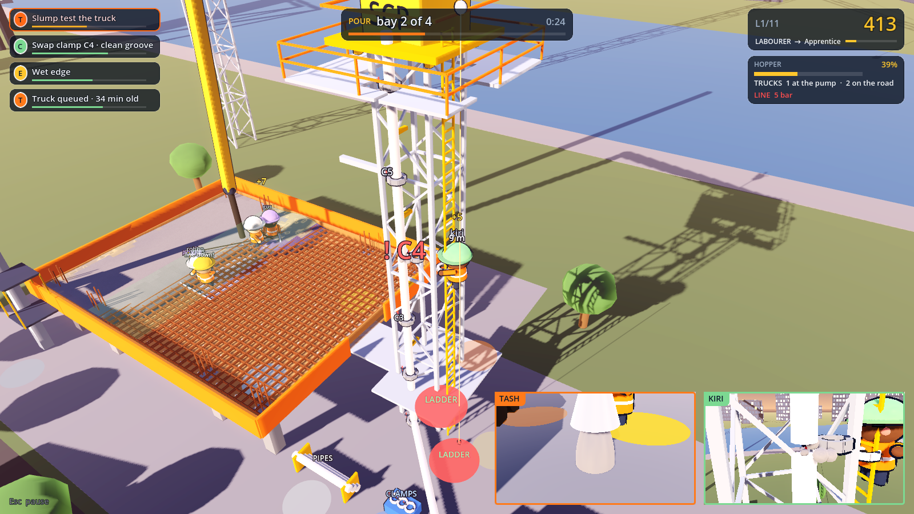

## Run it

1. Install **Godot 4.3 or newer** (the standard build, not .NET) from godotengine.org.
2. Open Godot, choose **Import**, and pick `project.godot` in this folder.
3. Press **F5** (or the play button). The first open takes a few seconds while Godot imports the project.

## Play on the TV with phones as controllers

Run the game on a laptop or PC plugged into the TV. The start screens and the pause menu show a QR code and an address like `http://192.168.1.23:8080`.

1. Each player connects their phone to the **same Wi-Fi** as the computer.
2. Scan the QR code in the **Join in** card on the crew screen (it's big enough to scan from the couch), or type the address under it into the phone's browser. It's in the pause menu too.
3. Tap to join, and turn the phone sideways.

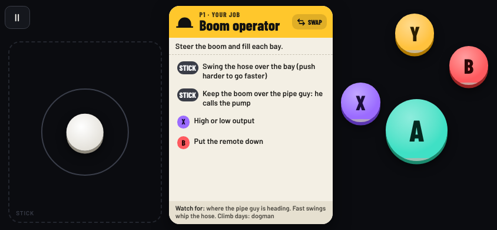

The phone becomes a controller: a stick on the left and **A B X Y** on the right, with your crew member's name and your job (its icon, in its colour) along the top. Whatever the game wants you to press pulses on your phone and over your chibi on the TV at the same time. On Android the phone also buzzes in your hand: the poker's rumble, each hammer blow, a clamp clunking shut. Buttons squash in, ripple and throw sparks in their own colour when you press them and spring back when you let go; a hold fills a ring round the button in step with the one on the TV, and the stick's rim lights up the way you're pushing. A quick tap always counts, even when the Wi-Fi bunches the press and the release together. The first phone takes over Player 1 if nobody has touched the keyboard; each phone after that takes the most useful job a bot is doing. If a phone drops out, open the page again and it reconnects to the same chibi.

**Pause from the phone.** The Pause button, top left, pauses the game; the stick, A and B then work the pause menu.

**Full screen on the phone.** On Android the controller goes full screen on the first tap (and a corner button puts it back if you swipe out). An iPhone doesn't let a web page do that, so the join screen says how: tap Share, then **Add to Home Screen**, and open Pour Decisions from the home screen. It then opens like an app, sideways, with no browser bars, and joins the same way.

On Windows the first run asks whether Godot may use the network: allow it on **private networks**, or the phones can't connect. If the page won't load on the phone: check the phone's on the same Wi-Fi (not mobile data), allow Godot through the Windows firewall for private networks, and try the other addresses the Join in card lists (a computer with VirtualBox, Hyper-V or a VPN has more than one, and the game picks the Wi-Fi or Ethernet one first). If something else on the computer has ports 8080 and 8081, the game moves to the next free pair and shows that address.

## Controls

Four buttons and a stick, the same on phones, pads and keyboard:

| Button | What it does |
| --- | --- |
| **A** | Do the job. Take the end hose and call the pump on (pipe guy), start the pump, pick up, plunge, open or close (hold), pump (hold), slump test, use a tested load, sling a section, haul up the pin sets, hammer (hold, let go in the gold), R-clip, lower the load |
| **B** | Put something down, step off the ladder or hoist, leave a station, send a load back |
| **X** | Extras: the pump's high/low output (boom operator), hoist (dogman), add the water held back (after a slump test), wave the next truck in during a slump test, safety pin, tow the poker's drive unit |
| **Y** | Signals: "slowly" for the dogman (tap twice for emergency stop), "boom over here" for the poker |

| | Stick | A | B | X | Y |
| --- | --- | --- | --- | --- | --- |
| Keyboard P1 | WASD | Space | Q | E | F |
| Keyboard P2 | Arrow keys | Enter | Right Shift | Right Ctrl | Right Alt |
| Pads 1–4 | Left stick | A | B | X | RB |

If you're playing on the keyboard, every button cue over your chibi shows the key too, like **kill the pump [Space]**, so nobody has to remember which key is A.

In the main game there's no step-by-step instruction text: every action is a pulsing button glyph over whoever needs to press it, with a ring that fills on hold actions. (The water tower tutorial has a coach panel that talks you through it.) **Esc** (or a pad's Start, or the Pause button on a phone) pauses (screenshot below): carry on, **Your job** (what every button does in your job, on a pour and on a climb day), controls and phone joining, the settings, start again or quit. Mouse: right-drag to orbit, scroll to zoom. Keys: **F11** full screen (also in the pause menu, and remembered), **Tab** skyline, **R** restart, **F1** skip to the first climb, **F2** screen shake, **F3** sound.

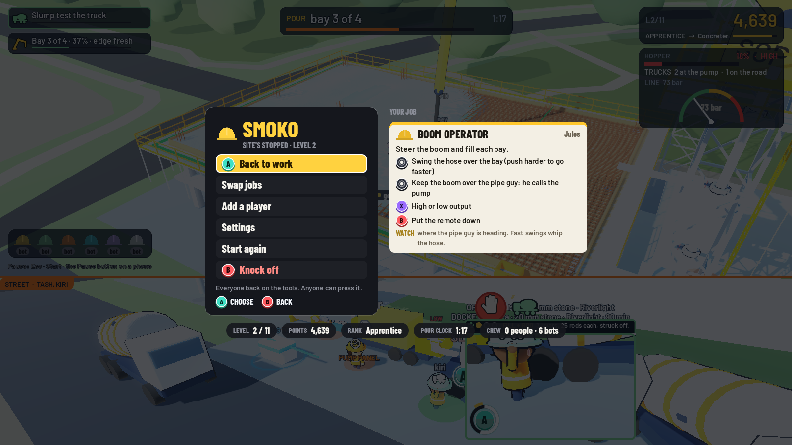

**Settings** (kept between sessions):

- **Incidents:** None, Normal (one clamp or blockage a pour), Busy (one a bay from level 3) or Chaos (one a bay, blockages too, from level 1). Takes effect from the next pour.
- **Load call help:** on, the truck's label also says the right call. (The slump reading itself always shows the call it points to.) Always on in the tutorial.
- **Screen text:** 100, 125 (the default) or 150%, for a big TV across the room. At 150% the job tickets drop below the task bar so nothing on the HUD overlaps.
- **Split screen:** auto (the default: the deck on top, the street along the bottom, once the crew are far apart) or off (one camera pulls back over everyone).
- **Camera test:** try the multiplayer cameras on your own. The camera treats some bots as people playing, with their button prompts showing: Deck + street (boom, pump), Deck + ladder (boom, pump operator), Two on the deck (poker, screeder), Deck, ladder + street, Four players, or the Whole crew. Not saved: it's back to Off next time.
- **Brand names:** real (SCP, Riverlight, Hamilton Reach, Watpac, the Putzmeister boom) or lookalike (PourCo, Rivermark, Harbour Reach), for streaming or showing the game round.
- **Names & labels:** 100, 125 or 150%, for name tags, station names and sign captions in the world. They also grow as the camera pulls back.
- Sound and screen shake.

### The HUD

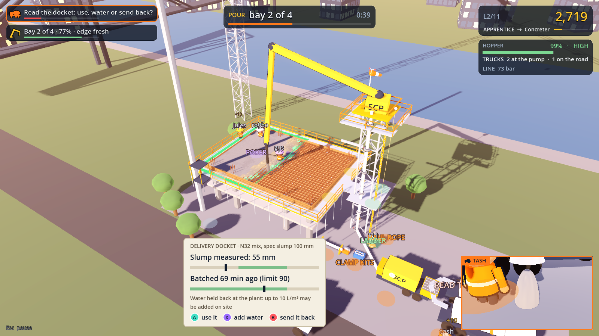

The screen stays clear: most of what you need is in the world (the hand signs, the button by your head, the close-up cameras), so the HUD only carries what you can't see there, and nothing is said twice.

- **Top centre:** what the crew's doing now ("POUR bay 3 of 4", "CLIMB pin 2 of 4: drive the pin"), its progress bar and the pour clock.
- **Top right:** level, points and rank. Under it while pouring, the pump: hopper level and whether it's on HIGH or LOW, trucks at the pump and on the road, and the line pressure. The wind shows only on climb days or when it's gusting.
- **Left:** the live jobs, most urgent first, each with a countdown bar and the icon of the job it's for, in that job's colour. Urgent ones get a coloured border and pulse. The boom operator's one is their progress: "Bay 2 of 4 · 64% · edge fresh", its bar filling with the bay and coloured by the wet edge (green fresh, amber ageing, red going off).
- **Centre:** one-line call-outs that fade.
- **Close-up zoom-ins:** hands-on work a person's doing (a clamp, a pin, a slump test) pops up a zoom-in right beside the spot where it's happening, in whichever view shows it (the deck view, or the street band when the screen's split), framed in the colour of the job, with your button cue in the corner. It's sized to the screen, stays inside its own view, and keeps clear of the other pop-ups and of the pump. A failing clamp gets one when the pump operator's a person. Bots' work gets no pop-up. Anyone off the screen gets a small view in the deck view's bottom right corner.

Station names on the ground only show when that station is wanted or you're standing near it.

### Deck and street: the split screen

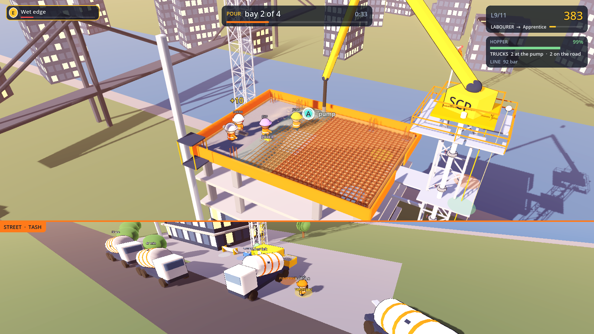

When people are working both up top and down on the street and they're far apart (up past 9 m, or more than 12 m away, which the truck bay is from the deck even on level 1), the screen splits rather than pulling one camera back until everyone's a speck. The main camera never pulls back further than 30 m on its own (the mouse wheel still can). The split closes while the slab report's up, and the report and the day's briefing always sit on top of the street band. The deck view slides up into the top two-thirds and a street band opens along the bottom. The street band has its own camera on the truck bay and the pump, is framed in the colour of whoever's down there, and moves in close for hands-on work like a slump test. When everyone's back at one height, the band slides away again.

Anyone partway up the ladder (the pump operator swapping a clamp halfway up) gets a marker on the line between the two views, with their name and height, and their own close-up while they work. Close-ups sit just above the street band.

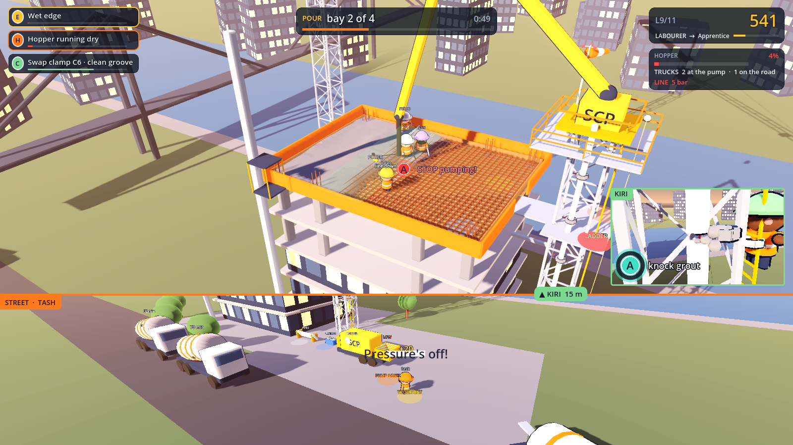

## Pick your crew: who you are, and your job

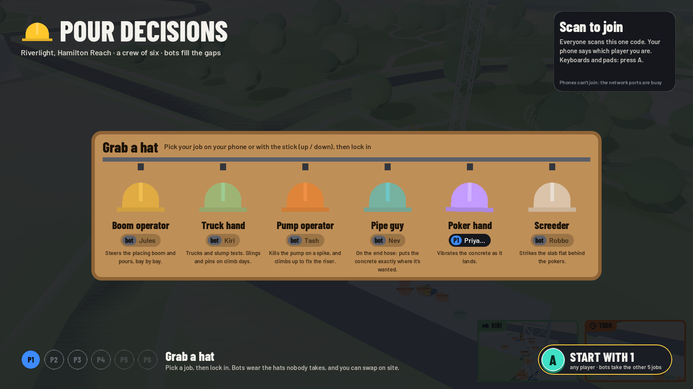

Every person picks one of the named crew with the stick (left/right) and a job (up/down), then presses A when they're ready: Macca, Tash, Gus, Priya, Robbo, Jules, Nev or Kiri, each with their own look. The hard hat is always the job's colour with the job's icon big on its crown, and every job's icon is also on the crew cards, the job list, the hand signs, the close-ups, the pause menu and the phone), so jobs are never told apart by colour alone. Once everyone's pressed A there's a three-second count; B, or someone new joining, stops it. Bots are whoever's left, on every job nobody picked, and they work through the same buttons a person presses. The strip along the bottom shows who's on every job. Keyboard P1 can swap jobs mid-game with **1–6**, and keeps their character.

| Job | On a pour | On a climb day |
| --- | --- | --- |
| **Boom operator** | Walks the deck with the radio remote, steering the hose and pumping bay by bay | Dogman: whistles the crane in |
| **Truck hand** | The truck bay: waves trucks in and spots them back onto the hopper, slump-tests every load, checks its docket against the order and makes the call | Slinger: slings the next section on the laydown, then sends the pins up the haul rope |
| **Pump operator** | Watches the pressure gauge on the side of the pump and kills the pump (A) the moment it spikes, points for how fast, then restarts it. A spike is often the line going: kill it, climb up and fix the riser (weeping clamp, burst or blockage), fetching their own parts. Opens the washout valve | Rigger: jacks the frame, pins the new sections |
| **Poker hand** | Vibrates the concrete as it lands | The tag line |
| **Screeder** | Strikes the slab flat behind the pokers | A breather (and some staff tricks) |
| **Pipe guy** | On the end hose: puts the concrete exactly where it's wanted, right into the corners, and does the radio calls at the start-up | A breather |

Where does the boom operator stand? On a real job, on the deck: a belly-box radio remote, a few metres back from the hose end and off to the side, out from under the boom, where they can see the concrete landing. That's what the boom operator does here: they walk with the pour while you steer.

### The gold assist

Every job's button lights up **gold** at the moment, or in the spot, where pressing it is the right call, the same way on the TV, in the close-ups and on the phone (with a shower of gold sparks and a little buzz the moment it turns):

| Job | Gold means |
| --- | --- |
| Boom | The hose tip is over the leading strip of the bay, where concrete's wanted now (when nobody's on the end hose: otherwise the pumping is the pipe guy's) |
| Poker | **Plunge:** you're over a good patch of purple. (When it's done there, or won't reach further, the button goes red and shakes instead: let go.) |
| Screeder | Board down over vibrated, unscreeded concrete, and "keep pulling" while the board's finishing as it goes |
| Pump | Kill the pump the moment it spikes (flashes red); restart after a spike (once the line's fixed); stroke the pump before the line goes off; tapping at the blocked pipe; swap a weeping clamp |
| Truck hand | Wave the next truck in now; let go of A as the reversing truck's readout flashes green STOP; the slump test steps; the right call on a load (with Load call help on) |
| Pipe guy | Radio the moment the hose puffs or the colour changes |
| Climb day | Pump the ram, podger in when the holes line up, sling when the hook's down, lower when the load's over the ghost, let go in the hammer's gold band |

Gold belongs to the assist and nothing else: the assist ring has its own look (a white inner ring, a gold outer one and gold dashes turning round it), the "+N" points pops are white, and a screeded patch that's ready glows a cool green-white.

**Gold assist** is a setting in the pause menu (on by default), so you can try the game with and without it. The hammer's gold band is the mechanic itself, so it always shows.

### The scaffold walkway

A scaffold walkway runs right round the slab, off the concrete, with a handrail and toe boards on the outside. It climbs with the deck. The **boom operator works from it and never steps on the pad**: on the remote they work from the front walkway (the side nearest the camera), keeping in line with the pipe guy so they can see the concrete landing. They pick up the remote at the south-east corner of the scaffold, and on a climb day the same spot is where they dog the new section in: BOOM REMOTE on a pour, DOGMAN on a climb.

**Footprints.** Boots leave prints in fresh concrete. Prints in concrete that hasn't been screeded yet don't matter (the screed takes them out), but walking back over the **screeded finish** spoils it: it costs points and that patch needs the screed again. Once the concrete has gone off, it doesn't matter. So the walkway is the way to get round the slab without walking through the work. (The bots step lightly: prints are for people.)

### The pour plan on the scaffold

A bold green line along the scaffold walkway marks the pour so far: alongside every bay that's been poured plus the one going in now, with a thin green line across the slab where the next joint is. It's out on the walkway so it never covers the slab's edges, and it grows bay by bay until it rings the whole slab, square or round.

### Station spots

Every work spot on the ground and the deck (BOOM REMOTE, DOGMAN, TAG LINE, RIGGER, TRUCK BAY, PIN BAGS and the rest) is in the colour of the job that works there. Deck spots sit just above the concrete so the slab and the rebar never hide them; people stand on them properly (their legs in front), and if anything does cover a spot (a truck, a crowd) a faint copy shows through. They're left out of the close-up views.

**Labels never print over each other.** Just before each frame is drawn, the floating labels are tidied on screen: the hand signs win, people's name tags step up (or down) out of each other's way, and station names, truck dockets and status lines give way until there's room. Queued trucks' ages only show to the pump operator nearby.

### Hands-needed signs

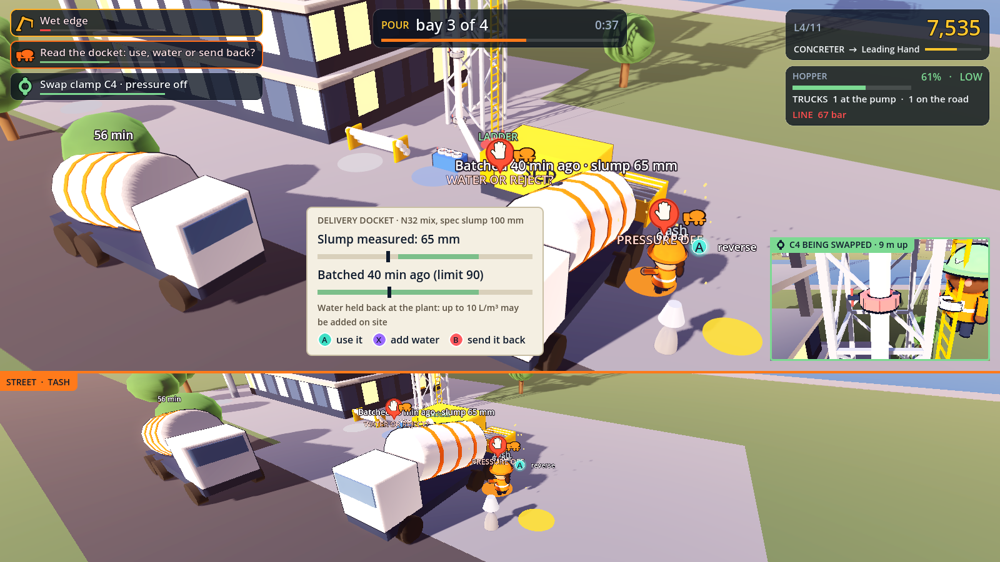

Anything that needs a worker gets a small orange marker with a hand on it and the icon of the job it's for, floating over the spot: the poker's drive unit when nobody's holding it, a truck waiting on its slump test, the pump panel when it's ready to restart, a clamp weeping up the riser. When it gets urgent it turns red, and when it's critical it shakes and throws sparks. Bots run for their red signs. Bots also call out what they're doing in little speech balloons that float up off their heads and pop ("Clamp coming up!", "On it!"). A balloon is sized to its words, with a tail down to whoever said it: a long line wraps onto two or three lines rather than running wide, and newer balloons push older ones up so they never overlap. A sign for your job that's off the edge of the screen (or behind the street band) gets an arrow on the screen's edge in your job's colour, pointing to it.

### Points and ranks

There are no stars. Every bit of real work earns points the moment it's done, and a small "+N" rises off whoever did it: concrete placed in the right bay, each spot poked, screeding, slump tests, good calls on bad loads, every repair step, safety pins, sections landed, clean hammer blows, R-clips. Mistakes cost points (a burst, a hose whip, a bad load accepted, a pin left without its clip).

At the end of each slab the report adds a **quality bonus** (the engineer's score out of 100, times six) and a bonus for finishing early. The total climbs a rank ladder with no ceiling on points: Labourer, Apprentice, Concreter, Leading Hand, Foreman, Site Super, Concrete Legend. An all-bot crew finishes the chapter around Site Super.

Every slab also gets a **medal**, the way a builder would judge the pour: was it good, and was it quick? Silver takes 85% quality inside the silver time, gold 95% inside the gold time (the report shows both, and they ease up a little as the riser grows, plus 3 s for every person playing, since people talk, look about and learn). The times are set against what bots do: bronze bots on the tower take about 80 to 110 s, so silver (86 s) and gold (77 s) mean a crew that's working well together. The chapter's end tallies them.

**Bots slip, like people.** A bronze bot loses about 6 seconds twice a slab ("Where'd I put the…", a phone call, a boot lace), a silver one once, a gold one never, so a bot crew isn't a perfect machine to measure yourself against.

**The bots work at your level.** They start on bronze, a bit slower on their feet and only switching the pump's output when it really matters. Each time the crew beats the bots' medal they step up one (silver, then gold: full pace, sharp on every call), and step back down if the crew falls short. So good players aren't held back, and new ones aren't left behind. An all-bot crew stays on bronze bots (though a lucky run of trucks can still earn it a silver).

## Pick the job and the kit

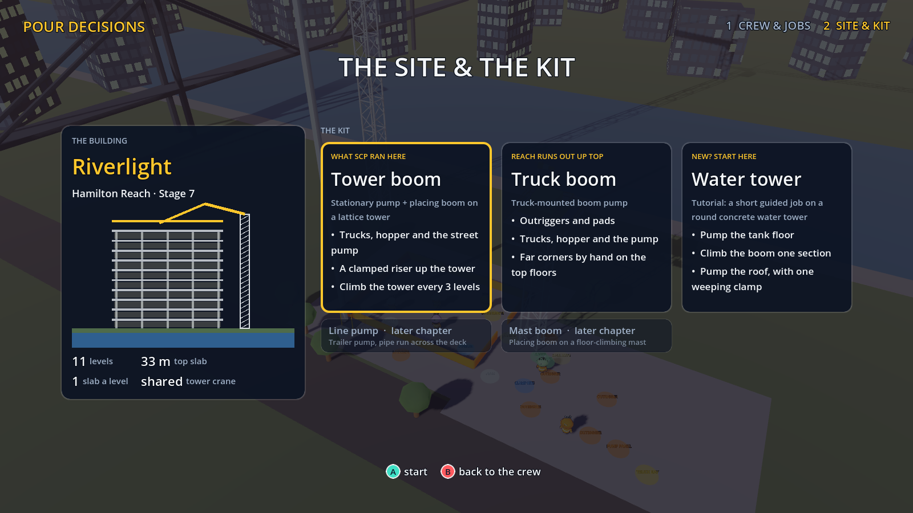

Next comes the building, Riverlight at Hamilton Reach (11 levels, a 33 m top slab, a shared tower crane), and the kit to build it with. The first player picks (it says who); B goes back to the crew. The two kits you can play now are the big cards, with the tutorial beside them; the later chapters' kits sit small underneath.

- **Stationary pump + placing boom on a lattice tower.** What SCP ran on Riverlight.
- **Truck-mounted boom pump.** Outriggers before every pour, no climbing, and on the top floors the far corners are out of reach.
- **Water tower (tutorial).** A short guided job, below.
- **Line pump** and **floor-climbing mast**: coming in later chapters.

## The water tower tutorial

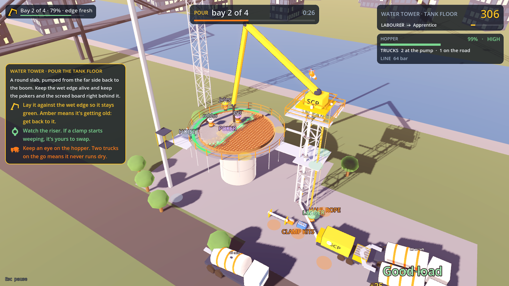

A concrete water tower's pedestal is a round shaft, cast in lifts a couple of metres high with jump forms (pour a lift, climb the forms, pour the next), or slipformed day and night. At the top it flares out in a cone to carry the tank; the tank floor, its wall and the roof are cast on top ([jumpform and slipform](https://www.designingbuildings.co.uk/wiki/Jumpform_v_slipform), [a pedestal tower's construction](https://patents.google.com/patent/US8261510)).

The tutorial starts with the shaft already up. The crew pumps the round tank floor, climbs the boom one section (slinging it on the laydown, hauling up the pin sets, dogging it in and pinning it), then pumps the roof slab over the tank wall, with one weeping clamp for the truck hand. A coach panel down the left says what's going on and, for each person playing, the next thing their job needs, with its icon. It's a mild, still day: no rain, no traffic, no defects, and load call help is on.

## The jobs

| Job | Where | What it's like |
| --- | --- | --- |
| **Boom** | Deck | Take the radio remote. The stick steers the boom. **The pipe guy on the end hose turns the concrete on and off**, so your job is to keep the boom over them and along the wet edge. With nobody on the end hose (or once the pipe guy's stood quiet for a while), hold A to pump yourself; you also pump the start-up slurry and the washout into the bin. The stick is mapped onto the slab: left and right run along the slab edge that reads left to right on screen, up and down go from the far edge to the near one, so the boom moves square to the pad whichever way the camera's turned. The boom moves like a real one on a radio remote: a small push creeps it, a full push swings it, it eases off while you're pumping so you can place, and it stops where you let go. Hold it hard over for more than a second and it winds up, to twice the speed. Swing it that fast and the end hose starts to whip: lumps of concrete fly off across the slab, and the pipe guy gets swung off their feet like a pendulum, arms and legs flailing, still hanging on. **X switches the pump between high and low output**, and X pops up beside you when it's worth it: drop to LOW when the hopper's running low between trucks, when a clamp's weeping, or to top up the last of the slab gently; back up to HIGH when a truck's feeding again (it glows when the wet edge is getting old). It flashes red when it's urgent, like the hopper about to run dry. If a clamp starts weeping or the line blocks, whoever's pumping gets a red, shaking A: let go and stop pumping until the pump operator has fixed it. With nobody on the remote, the pump picks its own output. |
| **Poker** | Deck | Grab the poker at its drive unit. While you hold it, concrete that still needs vibrating glows purple (red when it's about to go off). Plunge (hold A): the concrete shudders, air bubbles pop up, the drone strains. Keep holding and you can creep it along slowly, about a metre from where it went in, working the purple as you go. When the bubbles stop and it turns glossy, or you've reached as far as it'll go, the button goes red and shakes: let go, walk on, and plunge again where the button goes gold over the purple. Walk past the end of the shaft and you drag the drive unit along. Hold too long and bleed water comes up. |
| **Pipe guy** | Deck | The end hose hangs off the boom tip: walk under it and press A to take it (its spot, END HOSE, follows the tip round). Now the concrete comes out of *your* hands: walk it where it's wanted, slowly, up to 2 m from under the tip (go further and the boom drags you along). That's how it gets right out to the forms and into the corners, which the boom alone can't quite reach. The button goes gold where the concrete's wanted now (the leading strip of the bay being poured). **Hold A to pump, let go to stop**: the concrete is your call, whoever's on the boom remote; they keep the boom over you. On the start-up you're on the radio (A from anywhere): "the dragon's breathing" and "concrete's on". B lets go of the hose. A second person joining gets this job, so the two of you work the boom and the hose together. With nobody on it, a bot does it, steering the hose into the low spots in reach. |
| **Screed** | Deck | The screeder always has the board: upright at their side like a staff, and if they're left standing with nothing to do, they spin it round like a bow staff (any button or a nudge of the stick stops the show). While you're on the pour, vibrated concrete that's ready to screed glows gold. Hold A and the board swings down into the screeding position, then walk: you face the board and walk backwards, slowly (it's a steady pull, not a jog), pulling it toward you and sawing it side to side, the way a concreter strikes off a slab ([technique](https://app.studyraid.com/en/read/118589/5472539/ruling-off-with-straight-edge-technique)). The board cuts the high spots down and the surplus rolls along in front of it into the low spots. Pull it right up to the formwork and you step out over the form to finish the edge; the surplus goes over into the barrow instead of being left in a heap. Screed it before it goes off. Concrete that's already gone off (a ridge left behind after a stoppage, say) still gets knocked down to level by the board, but it tears instead of finishing: it looks rough and still counts against quality. |
| **Truck bay** | Ground | Wave a truck back (A). Loads that need a **slump test** get one by hand, in its own close-up (see below). Then your call: **A** uses it, **X** adds the water the plant held back (right for a stiff load, then mix and test again), **B** sends it back (too wet, or batched over 90 minutes ago). A wrong call plays out later: water a good load and it's too wet to use, use a stiff one and it can block the line, use a wet or old one and it leaves a weak patch. |
| **Pump** | Ground, then up the riser | **Watch the gauge** on the side of the pump: a big dial with a red band, and the reading floats over it in big type, sized for the TV from any camera. Every so often the line starts to pack and the pressure spikes. Half a second before it does, a small close-up of the gauge pops up over the pump (inside the street view when the screen's split, and clear of the other close-ups) so you see the needle jump, with the A to kill it. **Press A anywhere, on the street, the deck or up the ladder, to kill the pump.** Under half a second is a lightning stop (+40), under a second +25, under 1.8 s +15. Most spikes are the line going: a clamp starting to let go, or a plug forming. Killing the pump is the first step of the repair, and it takes the pressure off the line at the same time, so the joint can be opened straight away. Then climb up and fix it, and hold A at the **PUMP PANEL** to restart once it's done (the pump won't restart into a broken line). A random spike with nothing broken is just a restart (a bot restarts it if nobody does). Leave any spike 3 seconds and it costs you: a clamp that was letting go blows, and a random one packs the line solid or cracks a joint. When the line's sitting still, A there strokes the pump to keep it from going off. |
| **Pump operator** (repairs) | Ladder | Swap a weeping clamp before it bursts, remake a burst joint, and find and replace a blocked pipe section. Grab the part on the way (CLAMP KITS or PIPES), or someone can send it up the haul rope. The safety pin takes a moment (hold A); B skips it to get the line back sooner, but that clamp is the next to weep, works loose faster, and it's a safety mark on the report. |
| **Dogman, tag line, rigger, slinger, pin sets** | Deck and street | The boom climb, every 3 levels (tower kit). |

### The slump test

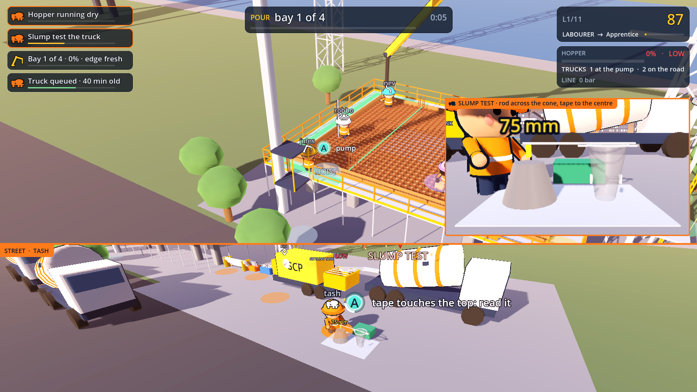

There's no docket on the screen. The slump test is done by hand at the truck bay, the way it's done on an Australian site (AS 1012.3.1, with the load judged against the order under AS 1379), in a close-up that pops up (bigger than the other close-ups) with you in it:

Four presses a load, and each one stops itself at the right point, so anyone can do the test the first time. A guide sits just above the close-up: the four steps in a row, ticked off as they're done with the one you're on lit gold, and a line under them saying what you're doing and why.

1. **Sample** (press A): you walk over to the truck's chute with the green tray, fill it off the running load and carry it back to the plate.
2. **Fill and rod** (one hold of A): the cone (300 mm tall, 200 mm base, 100 mm top) goes in **three layers** of about equal volume, each filled to its yellow ring and rodded **25 times** with the 16 mm rod to push the air out, then the top's struck off with the rod. Let go part way and it waits for you; it stops itself when it's done.
3. **Lift** the cone straight up, steady (hold A, a fresh press). Stop part way and you get a moment's grace; stop longer than that and it jerks: one side shears off, a shear slump isn't a test, so scoop it back and do it again. A lift with no stop at all is a bonus.
4. **Measure** (press A): the cone goes upside down beside it with the rod across the top, and the tape runs down from the rod until it touches the concrete. It's read off to the nearest 5 mm. The reading then shows the way: gold and bold with a tick when it's in spec (A glows gold), blue with water pouring over the cone when it's stiff (X turns water-blue), red when it goes back (B flashes red).

The guide then says what the reading means: how far it dropped against the order (a 100 mm pump mix, ±20 mm), and whether to use it, add the water the plant held back (10 L/m³, then the driver mixes it in and the load gets tested again), or send it back (out of spec, batched over 90 minutes ago, or the wrong mix on the docket). The caption on the close-up keeps the reading and the load's age.

**The pour doesn't stop for the test.** Once you go for the sample, the driver keeps the chute running into the hopper on trust, slowly (up to 2 m³), while you test. A quick, clean test means the call comes before much has gone in; a bad load caught late has already put some in the hopper (half as harmful, mixed with good concrete, but a wet load still leaves a weak patch where it lands). The test itself runs about 10 seconds.

Watering doesn't always land on the order: the driver adds what the plant held back, and a very stiff load can still be stiff after it, so the retest matters. The label on the truck only says a load "looks off at the chute", never which way: that's what the test is for. Some loads sit just outside the limits, so read the tape carefully.

On the tower **every load gets a test** (the truck pump's smaller slabs only test the first and any that look wrong). The truck's docket is on its side, with the order above it: now and then the plant sends the wrong mix (the wrong strength, stone size or site), and that load goes back whatever the slump reads. While you're testing, **X** waves the next truck onto the free side so the pour doesn't stop. If nobody comes to test or call a load for 20 seconds, the driver does it (agitator drivers often do), which costs the crew.

Sources: [MixHub: concrete slump test](https://www.mixhub.com.au/guides/concrete-slump-test), [CCAA: Concrete testing and quality assurance](https://www.ccaa.com.au/common/Uploaded%20files/CCAA/Publications/Technical%20Publications/PART_VIII_-_26_-_CONCRETE_TESTING_AND_QUALITY_ASSURANCE_GTCC_2020.pdf), [DIT SA ST-SC-S7 Supply of concrete](https://dit.sa.gov.au/__data/assets/pdf_file/0010/1423783/ST-SC-S7-SUPPLY-OF-CONCRETE.pdf).

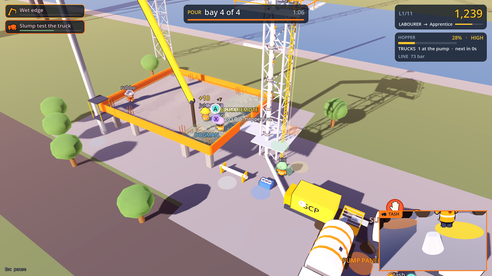

**Button prompts** sit small, just beside your chibi's head, so the name tag above stays readable.

**Pokers first, then the screed, forgivingly.** The screed board only finishes concrete that's been vibrated (it tells you if it's skating over purple), but a small missed spot with vibrated concrete all round it counts, so you never get stuck hunting for slivers. **Poker and screeder don't undo each other.** Screeding never spoils vibration and a poker never spoils a screeded finish, so the two jobs can happen in either order. Vibration also carries into small missed slivers between plunges, and a little extra concrete topped up on a vibrated patch doesn't turn it purple again. Each "VIBRATE HERE" sign hangs right over a patch that's getting close to going off.

**A first.** Every job's main action is A. X, Y and B are for the calls that matter: the boom's high/low, the dogman's hoist and "slowly", and the call on a load (use it, add water, send it back), where the right button is the one you have to know.

**Can't see it? It comes to you.** A clamp weeping or bursting halfway up the tower, or a blocked pipe, pops up in its own close-up window with its name and height, wherever you are.

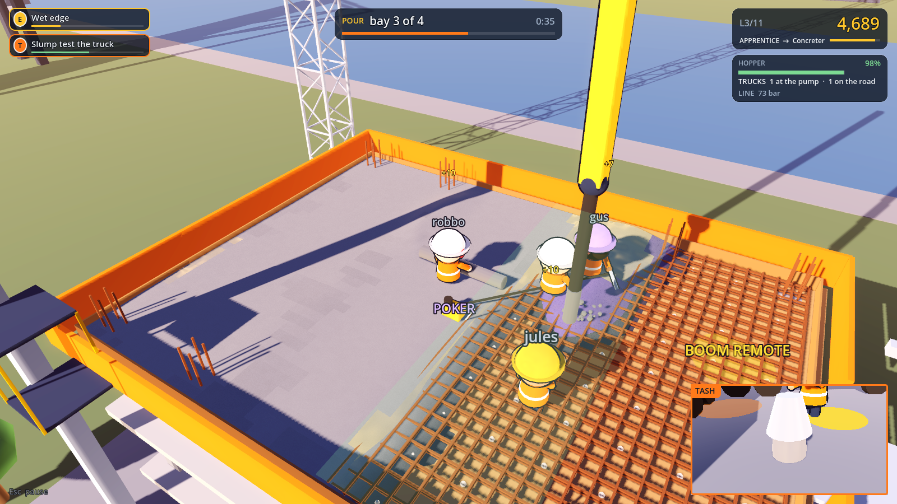

### Keeping the hopper fed

A real pump hopper is a small buffer, a minute or two of concrete, and on a good pour it never runs dry. That isn't because it's big: it's a **twin truck feed**. Two agitators back in from the east side by side, their rears just short of the hopper, each with an extra chute section swung in to reach it. One discharges while the next stands by, tested and ready, and the moment the first is empty the second starts. The trucks drive like trucks: they pull up along the road, then reverse onto the hopper on a turning path, and drive forwards out onto the far lane to leave. Only one manoeuvres at a time, and a reversing truck stops dead if anyone is behind it (WorkSafe QLD: nobody stands between a reversing truck and the hopper; twin feeds may need a spotter for each truck). The truck bay and the slump cone sit just south of the hopper, so the truck hand can test the next load while the first one pours, and everything they need sits along one clear lane to the tower: the bay, the **PUMP PANEL** beside the pump, then the parts store at the tower's foot (**CLAMP KITS**, **PIPES** and the **PIN BAGS**) next to the **HAUL ROPE**. No trucks in the way. Run the hopper dry on high and air goes up the line and the hose whips. (The truck pump kit only has room for one truck at a time, because its own outriggers take up the second side.)

**The truck hand's loads.** Each load gives the truck hand something different to do:
- **Spotting it back.** Wave a truck in with A and you're its spotter: it only reverses while you hold A, and it stops where you let go. A big readout over the truck's tail counts down the metres to the wheel stops (white, then amber as it creeps), and the moment the chute's over the hopper it flashes green **STOP!** with a ding and the yellow wheel stops behind the tyres light green: let go then ("Spot on!" pays most). Hold on too long and it backs into the hopper. Walk off, or stand there without waving it on, and the driver backs in on their mirrors.
- **The docket.** Every load's docket is on the truck against the order (40 MPa, 20 mm stone, Riverlight). Now and then it's the wrong mix (the wrong strength, the wrong stone or another site's load): it goes back whatever the slump reads, so B sends it back at the call. (On the truck pump's smaller slabs, loads not due a test only get the docket check: A pours a right one, B sends a wrong one back.)
- **The slump test** on every load, four presses (below).
- **Tight changeovers.** Each new load whose chute opens before the hopper's run low grows a streak, and each one pays more. Let the hopper run low between trucks and the streak's over.

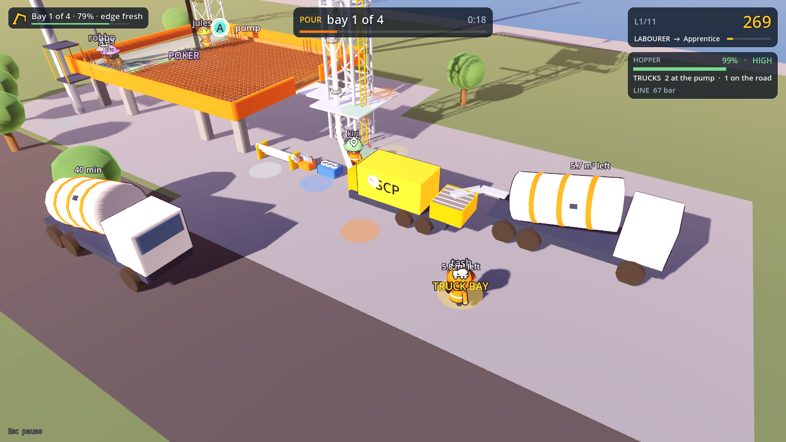

### The line: real parts, carried by hand

The riser is 3 m pipe sections with a quick-release clamp at every joint, bracketed to the tower. Spare **clamp kits** (a clamp and its gasket) live in the blue **CLAMP KITS** bin at the foot of the tower, and spare pipes on the **PIPES** rack. Carry them with A, put them down with B. You can carry one up the ladder. The ladder is magnetic: let go of the stick anywhere near the joint being worked (or the deck, or the ground) and you're pulled to the exact working height, and if you climb past one you catch on it for a moment. No fiddling to line up.

Repairs can run in parallel. The pump operator can climb straight up and get the joint open while someone on the ground (the truck hand, say) grabs the part and sends it up the **haul rope** beside the ladder: carry it to HAUL ROPE and press A. It rides up over the gin wheel to the joint, and the pump operator takes it off the hook. You can also hand a part straight to the pump operator (A when you're next to them), or drop it by a joint on the truck pump.

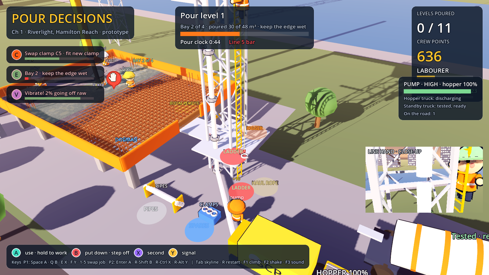

- **Weeping clamp:** it drips grout and knocks with every stroke, and its ticket counts down.
    1. Grab a clamp kit (or have one sent up) and climb to it.
    2. It starts with a spike: kill the pump (A) and the pressure comes off with it. The pump stays off until the joint's remade (nobody pumps with someone on the line).
    3. Open the clamp (hold A) and knock the old grout out of the groove (tap A).
    4. Fit the new clamp and gasket (A), close it (hold A) and put the safety pin in (X).
- **Burst:** the pump trips and nothing pumps until the joint is remade. Same steps, minus opening.
- **Blockage:** a still line goes off.
    1. Tap along the riser with A: a clear pipe rings, a packed one thuds.
    2. Fetch a new pipe and open the clamps at both ends.
    3. Lower the plugged section, fit the new one, then close and pin both clamps.

**Nobody gets stuck.** A party game on a TV can't leave the room watching a line that never comes back, so the line looks after itself when someone misses their cue:

- A blockage only blows one joint. Pump into it again and the pump's relief valve cuts in and it just stalls at full pressure.
- One thing goes wrong at a time: no new failure starts while the line's blocked or a joint's being worked on, and the line doesn't go off while a joint's open (the crew wash it through), so a long repair can't turn into a second blockage.
- A blockage nobody's found after 30 seconds is heard by the pump operator, and a repair that drags past 80 seconds gets the leading hand jumping in to finish it.
- **Finishing can't hang.** If the last of the vibrating and screeding stops getting smaller for 12 seconds (or it's been 45 seconds since the last load), the concreters finish the last bits by hand, for a small points cost.
- **Crewmates cover.** If someone's job has been waiting on them (a red sign) for 15 seconds and they haven't touched their controls, a crewmate covers it: the job's bot drives their chibi until they press anything, and then it's straight back to them.

### Pinning a tower section

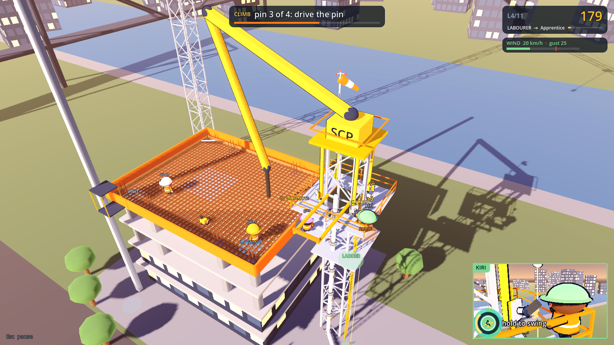

You can see every part of it: the lug plates and their holes, the podger, the lump hammer, the pin and the R-clip. The rigger works from the climbing frame's walkway below the joint, so the pins sit at chest height. The walkway boards stop short of the riser, its clamps, the ladder and the haul rope, so none of them disappear behind the decking.

1. **Line up the holes.** The new section's lug plate sits off the frame's, and its hole glows red. A yellow arrow shows which way to push the stick. Inch it until the hole glows green. Every corner needs lining up.
While you line up, the rigger has the podger bar through the holes and levers on it with the stick, and you can see the plate move with it.
2. **Podger in (A).** It drifts the holes true. If they're still out, it just bounces off, with no penalty.
3. **Drive the pin.** The rigger squares up to the pin with the lump hammer in the right hand. Hold A to wind the hammer back up over the shoulder. A thick gold band on the button's ring shows where to let go: when you're in it, the ring fills gold, the button flashes gold and throws sparks, and the hammer head glows. Past it, the fill turns red. Let go: the hammer comes over and down and its face lands square on the end of the pin, with sparks and a clang, and the pin moves in. Three clean blows. The close-up camera watches the swing side-on from the hammer side, and shows the same button cue in its corner so you can time the swing from the close-up.
4. **R-clip (A).** It snaps through the end of the pin.

Jacking the frame up between sections: press or hold A. Each stroke goes as soon as the ram is back, and the button's ring shows it coming back. The crane doesn't wait for you: the moment a section's slings come off and the pins start going in, it goes straight back to the laydown for the next one. The slinger can sling it while the rigger pins, and it flies up and hangs beside the tower, ready for the dogman the moment the gap opens. (A slinger bot sends the pin bag up first if the rigger's waiting on pins.)

**Slinging (the truck hand).** Each section stands on the **LAYDOWN** on the street. The crane drops its hook over it and waits: hold A to put the four sling legs on, one at a time. "Take it up!" and the crane lifts it straight up clear of everything before it swings it over. The street band moves in close while you sling.

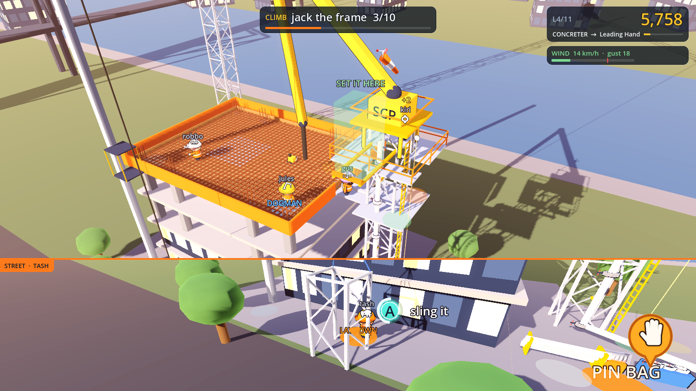

**Pins (the truck hand again).** A joint's four pins, each with its R-clip on, come in one sealed plastic bag from the **PIN BAGS** crate in the parts store. Grab one (A), take it to the **HAUL ROPE** and press A: it goes up to the climbing frame and the rigger takes it off the hook. The rigger pulls each R-clip off as they take the pin (no button for that), then lines up, podgers, drives the pin and clips it back on. No pins on the frame, no pinning.

### Dogging

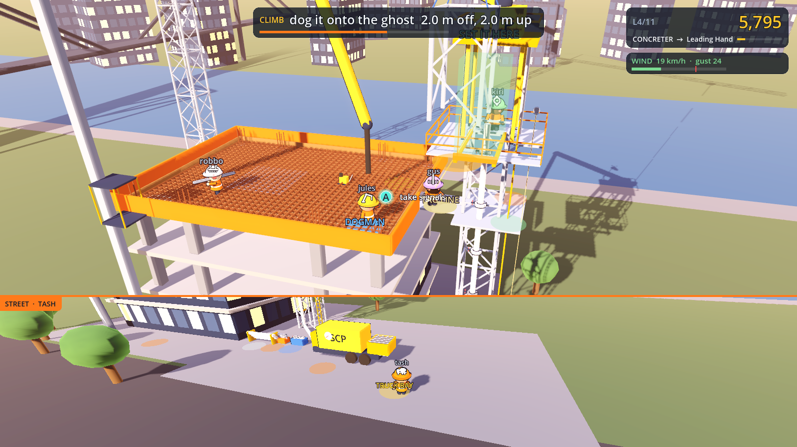

The camera swings round to the south while you dog a section in, so the load, the tower and the dogman's hand signals are all in shot side by side. The tag line goes on before the lift and hangs off the load all the way up ([CICB](https://blog.cicb.com/using-tag-lines-to-control-loads)). The tag-line job only opens once the crane has the load up higher than the deck and close by: wait at TAG LINE and hold A, and your chibi runs out to the dangling line on its own, grabs it and walks it back to the tag spot. Keep holding A to keep the line; let go and you drop it, and you're back in control wherever you're standing. The crane brings each section over but can't see the landing, so it hands it over off-target and swinging. Push the stick toward the green ghost: each push is a whistle call and a hand signal to the crane driver, who acts on it a moment later and slows down near the ghost. Let go of the stick and the driver stops (that's the "one short" whistle). When the ring under the load turns green, hold A to lower it in. A light knock just bounces it back off what it hit, and the crane driver eases off for a moment. Go gently: knock it hard into the boom head, the tower or the slab and the section buckles, drops off the slings and crumples where it lands. The crane then has to rig a whole new one, which costs time and points. Low over the runway, the crew on the platform get hands on it and steady it. If the wind gusts over the limit, the crane just holds until it eases. X hoists if you need height, and Y means "slowly".

## How a level plays

1. Columns, core, formwork deck.
2. Climb the boom (tower kit, every 3 levels) or put the outriggers down (truck kit).
3. Pre-pour briefing and the engineer's hold point. A defect like a missing bar chair has to be fixed first.
4. Pour the slab in four bays (split across whatever slab there is, so on the water tower they're slices of the round slab), far end first, keeping the edge wet, while the trucks, pump and line keep up. The first truck has already backed onto the hopper during the pre-start, so its slump test can be done while the line's primed, not with everyone watching it reverse in.
5. The pour isn't finished when the last of the concrete is in. The line gets washed out (below), and the slab only counts as done once it's all been vibrated and screeded too (the HUD shows what's left). Then the slab report (points, quality bonus) and the cure.

### Start-up and washout

Every pour starts by priming the line and ends by washing it out, the way a pump crew runs it. Each step is one person, one place and one button: it has a hand sign over the spot, a ticket on the left, a line under the task bar, and the button goes gold.

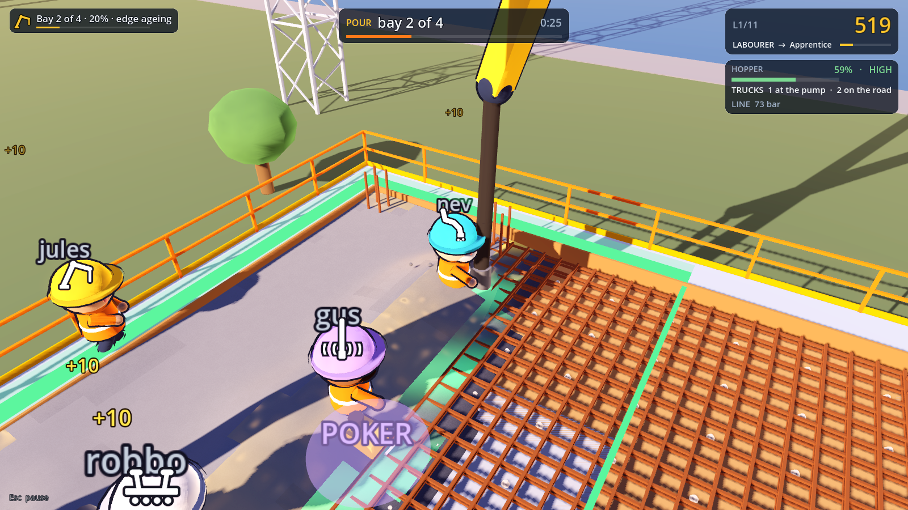

**Start-up** (the pour clock doesn't start until the concrete's on):

1. **Start the pump.** Pump operator, hold A at the PUMP PANEL.
2. **The dragon's breathing.** The pump pushes the air out of the line ahead of it, and hot air puffs out of the end hose. The pipe guy watches the hose and radios it down (A) the moment it puffs: on the dot is +15. Press before it puffs and the boom operator asks "not yet?". If a person doesn't call it in about 6 seconds, the boom operator sees it anyway and the pour carries on.
3. **Slurry in.** Pump operator, hold A at the panel to tip in the slurry (cement, sand and water). It coats the inside of the line so the concrete slides; it takes a moment to come up the line.
4. **Slurry into the bin.** Slurry mustn't go in the slab. The boom swings the hose over the BIN on the near scaffold, beside the last bay (the end of the pour, so at washout nobody walks across fresh concrete to reach it) (the pipe guy can walk the end hose to it) and pumps it in: the button goes gold over the bin, and missing it costs points.
5. **Concrete's on.** The grey slurry turns to concrete at the hose: the pipe guy radios the colour change (A, on the dot for +15), and the pour begins.

**Washout**, once the slab's full, using SCP's water washout ([SCP](https://scpaus.com.au/water-washout-clean-out-system/)): water pumped in behind the concrete pushes it out of the line, the last of it goes in a bin, then the water's blown back to the pump and into the settling tanks to be used again.

1. **Water in.** Pump operator, hold A at the panel: the hopper's cleaned out and filled with water.
2. **The last of it into the bin.** The boom puts the hose back over the BIN and pumps: the stream comes out grey (the last of the concrete), then blue (the water). Miss the bin and it lands on the finished slab.
3. **Blow it back.** Pump operator, hold A at the RELEASE VALVE by the pump: the water runs down the blue hose into the SETTLING TANK beside it. The tank stands on a big blue ring on the ground (seen through trucks and people), with its name over it, and an arrow bobs over it while the water's to go back. Its water rises as it fills.

Nobody gets stuck on any of it. A step nobody's doing gets a loud call after 7 seconds (and crewmates cover a quiet person after 15), the radio calls are made by a bot pipe guy on their own, and after 30 seconds the crew does the step themselves, for a points cost.

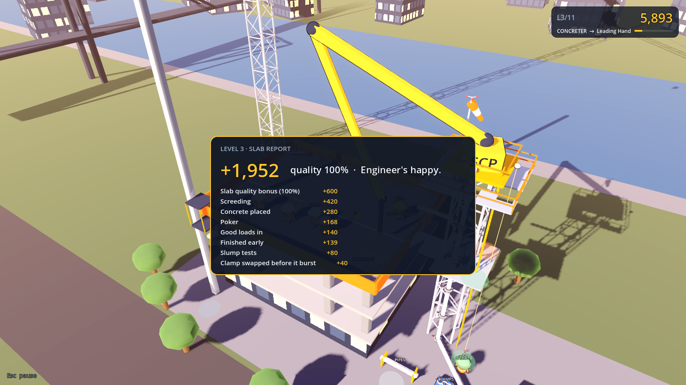

**Smoko** (a rest mechanic) is a concept for now: see [docs/smoko.md](docs/smoko.md). The worn-out look is built but only shows with the `--weary` dev flag.

### The boom and the pipe guy

On a real pour the pipe guy on the end hose and the boom operator work as a pair, and here they do too. The pipe guy turns the concrete on and off (hold A on the end hose), and the boom operator keeps the boom over them, so the hose reaches where they're working. A bot pipe guy calls the pump the same way: not into an empty hopper, a weeping clamp or a blocked line, and not while it's walking off a spot that's full. If a person on the hose stands quiet for a while, the boom operator's own A pumps again, so nobody stands waiting.

The boom's gold is judged where the tip is, not the boom, so the two of you are aiming at the same spot.

### Bots

The bots play through the same buttons as people. They find their way round anything in the way with a route search over whatever is walkable on their level, the deck or the ground, and they read every work spot off the site's stations instead of fixed coordinates. A bot that's pushing the stick but going nowhere sidesteps and re-plans. The screed bot works the slab in rows from form to form, and every row gets checked, including the ones right against the formwork; it only drops the board where there's concrete. Whatever a row can't reach (a corner, an edge, a patch the strips missed, or the curve of the round slab) it finishes with short pulls: it stands inside the patch, puts the board on it and pulls it in toward the middle, coming at it from another angle if the first pull didn't finish it. The boom bot pours the way a boom operator keeps a live edge: the bay is taken in strips from the far end back toward the boom, and the hose works the lowest spot in the leading strip until it's full, so each load goes against the last and the wet edge stays at the front, instead of filling low spots anywhere in the bay and leaving concrete behind to go off. The pump operator bot keeps its eyes on the gauge, kills the spike, grabs its own part on the way to the joint, fixes it and restarts the pump; the truck hand bot runs the truck bay.

## Project layout

| File | What it does |
| --- | --- |
| `scripts/main.gd` | Game flow, kits, levels and outside factors, stations, hoist, job list for the hand signs, tickets, slab report, cameras and close-ups |
| `scripts/crew.gd` | The six jobs, who's playing which, joining and swapping |
| `scripts/ops.gd` | The start-up (priming the line) and the washout, step by step |
| `scripts/roster.gd` | The named crew: names, looks and one-liners |
| `scripts/bots.gd` | The crew bots, one brain per job, driving the same buttons a person uses |
| `scripts/score.gd` | Points, the rising "+N" counters, the rank ladder |
| `scripts/signs.gd` | The hands-needed signs |
| `scripts/screed.gd` | The screed board, the surplus roll, the sawing motion |
| `scripts/slump.gd` | The slump test at the truck bay: cone, rod, barrow, tape and the close-up |
| `scripts/line.gd` | Trucks (with the standby truck), hopper, pump, which loads get tested and the call on each, the riser's sections and hinged clamps, parts, the haul rope, repairs, blockages and tap tests, hose whip |
| `scripts/poker.gd` | The poker: drive unit and shaft, plunge cycle, the tremble and air bubbles, the drone, over-vibration |
| `scripts/pour.gd` | The slab: concrete flow, open time and cold joints, vibration and bleed, bays, reach, rebar, screed |
| `scripts/climb.gd` | The boom climb: frame, tower crane, swinging load, wind, dogman whistles and hand signals, tag line, pinning props |
| `scripts/phones.gd`, `scripts/controller_page.gd` | The phone controller web server and the controller page |
| `scripts/qr.gd` | QR code generator for the join address |
| `scripts/player.gd` | Players: input (keys, pads, phones, bots), button glyphs, carrying, poses |
| `scripts/hud.gd` | HUD: task bar, points, pump and wind panels, job list, call-outs, briefing, slab report |
| `scripts/ui.gd` | The UI look: colours (one per job), panels, labels, button glyphs, bars |
| `scripts/pause.gd` | The pause menu (Esc): your job, controls and joining, settings |
| `scripts/settings.gd` | Settings kept between sessions |
| `scripts/icons.gd` | The job icons, drawn in code |
| `scripts/coach.gd` | The water tower tutorial's coach panel |
| `scripts/cue_badge.gd` | The button cue drawn in a close-up camera's corner |
| `scripts/select.gd` | The front end: pick your crew (character and job), then the job and the kit |
| `scripts/sfx.gd` | Synthesised sound |
| `shaders/` | Toon shading, outlines, windows, button glyphs, and the concrete surface (wet, going off, cold joints, honeycomb, bleed water) |

## Testing

An all-bot crew plays the whole chapter through the same controls a person uses.

```
godot --headless --path . --fixed-fps 60 -- --autotest
godot --headless --path . --fixed-fps 60 -- --autotest --kit=truck
godot --headless --path . --fixed-fps 60 -- --autotest --tutorial
```

Each slab prints its points and report, and the run ends with `TOPPED OUT with N points (rank)`. Other flags:

| Flag | What it does |
| --- | --- |
| `--letburst` | Lets a clamp blow, to test the burst-and-fix path |
| `--blocktest` | Forces a blockage, to test the tap test and the pipe swap |
| `--skip` | Jumps straight to the first climb |
| `--nophones` | Turns off the phone server |
| `--dbg` | Prints pump, truck and crew state |
| `--human=<job>` | Leaves that job to an idle "person", to see how the rest of the crew copes (a crewmate covers after 15 s) |
| `--nocover` | With `--human`, nobody covers the idle person, to test the line looking after itself |
| `--botcues` | Shows the bots' button cues in the close-up cameras (for screenshots) |
| `--weary` | Keeps the crew in the worn-out smoko pose all the time |
| `--collidetest` | Sets each section down against the tower to check it bounces off |
| `--uitest` | (without `--autotest`) clicks through the crew and kit screens and starts the game |
| `--startlevel=N` | Jumps straight to level N |
| `--cam=boom,pump` | The camera treats those bots as the people playing (to see the split screen in a test) |
| `--midclamp` | The clamp that fails is the one halfway up |
| `--tutorial` | Plays the water tower tutorial |
| `--incidents=N` | Incidents 0 (none) to 3 (chaos); autotest defaults to 1 |
| `--bots=bronze` / `silver` / `gold` | Pins the bots' level |
| `--noslips` | Bots never slip (to time a clean bot run) |
| `--camtest=N` | Starts with the pause menu's camera test on preset N (1 to 6) |
| `--nosplit` | Starts with split screen off |
| `--uiscale=1.5` | Sets the text size, to check the HUD at big text |

## Check with the crew

These follow published guidance, but SCP's own procedures should win:

- the whistle code;
- the hand signal chart;
- the pin procedure (podger, hammer, R-clip);
- the clamp swap and pipe replacement steps, and how parts really get up the tower (haul rope and gin wheel, or carried);
- screeding by hand behind the pokers, and whether SCP's crews use a vibrating screed instead;
- two trucks at the pump at once (standby truck backed in alongside);
- poker technique;
- the 90-minute docket guideline, and how much water a docket allows on site;
- the slump order and tolerance on SCP's pump mixes, how often loads get tested, and whether the pump operator or the driver does it;
- how sections are slung on the laydown, and how pins come up to the frame;
- Queensland noise hours.
