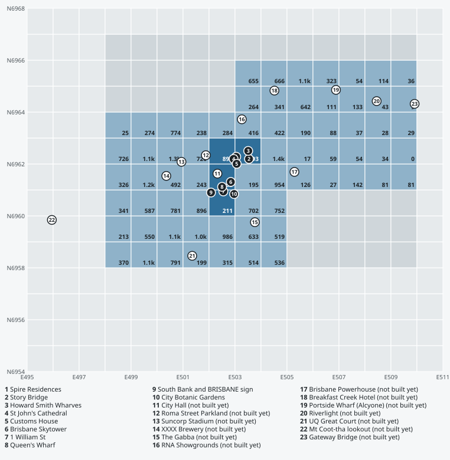

# Brisbane model: coverage

Made by `python3 tools/city/coverage.py`. Don't edit by hand. Rules and the detail ladder are in
[METHOD.md](METHOD.md).

Dark blue: measured tile with hand-built landmarks. Light blue: measured tile (2019 LiDAR). Grey: map and
aerial photo only. Dashed orange and dotted purple: the next two LiDAR orders. Numbers in the tiles are
building counts. Black dots are landmarks built by hand, white dots are landmarks still waiting.

| Measure | Now |
| --- | --- |
| Measured tiles (1 km each) | 96 |
| Share of Brisbane City (1343 km2) | 7.1 % |
| Buildings | 73724 (72103 with a measured height) |
| Trees | 298194 |
| Tiles with a hand-built landmark | 4 |
| Hand-built landmarks | 10 |
| Photo pairs (render matched to a photo) | 66 |
| City-wide buildings sharing one facade recipe | 97 % |
| Landmarks inside the model but still plain blocks | City Hall, Roma Street Parkland, Suncorp Stadium, XXXX Brewery, The Gabba, RNA Showgrounds, Brisbane Powerhouse, Breakfast Creek Hotel, Portside Wharf (Alcyone), Riverlight, UQ Great Court, Gateway Bridge |
| Landmarks outside the measured model | Mt Coot-tha lookout |
| Tiles in the next LiDAR orders | 1-fill: 0, 2-downriver: 0, 3-corners: 0 |

## Measured tiles

| Tile | Grade | Buildings | Trees | Photo pairs | Hand-built | Waiting |
| --- | --- | --- | --- | --- | --- | --- |
| 498_6965 | 2 | 1041 | 3166 | 0 |  |  |
| 499_6965 | 2 | 773 | 3711 | 0 |  |  |
| 500_6965 | 2 | 1220 | 3588 | 0 |  |  |
| 501_6965 | 2 | 960 | 3676 | 0 |  |  |
| 502_6965 | 2 | 909 | 3835 | 0 |  |  |
| 503_6965 | 2 | 814 | 2719 | 0 |  |  |
| 504_6965 | 2 | 788 | 2685 | 0 |  |  |
| 505_6965 | 2 | 1169 | 4226 | 0 |  |  |
| 506_6965 | 2 | 833 | 3342 | 0 |  |  |
| 507_6965 | 2 | 539 | 2391 | 0 |  |  |
| 508_6965 | 2 | 283 | 1889 | 0 |  |  |
| 509_6965 | 2 | 203 | 1848 | 0 |  |  |
| 498_6964 | 2 | 864 | 3521 | 0 |  |  |
| 499_6964 | 2 | 873 | 3732 | 0 |  |  |
| 500_6964 | 2 | 894 | 3314 | 0 |  |  |
| 501_6964 | 2 | 888 | 3186 | 0 |  |  |
| 502_6964 | 2 | 721 | 2800 | 0 |  |  |
| 503_6964 | 2 | 338 | 2324 | 0 |  |  |
| 504_6964 | 2 | 412 | 2078 | 0 |  | Breakfast Creek Hotel |
| 505_6964 | 2 | 813 | 2408 | 0 |  |  |
| 506_6964 | 2 | 339 | 1759 | 0 |  | Portside Wharf (Alcyone) |
| 507_6964 | 2 | 236 | 950 | 0 |  |  |
| 508_6964 | 2 | 126 | 1512 | 0 |  | Riverlight |
| 509_6964 | 2 | 13 | 630 | 0 |  | Gateway Bridge |
| 498_6963 | 2 | 869 | 3823 | 0 |  |  |
| 499_6963 | 2 | 964 | 3753 | 0 |  |  |
| 500_6963 | 2 | 1387 | 4184 | 0 |  |  |
| 501_6963 | 2 | 531 | 2996 | 0 |  |  |
| 502_6963 | 2 | 415 | 2563 | 0 |  |  |
| 503_6963 | 2 | 633 | 2826 | 0 |  | RNA Showgrounds |
| 504_6963 | 2 | 596 | 2677 | 0 |  |  |
| 505_6963 | 2 | 630 | 2955 | 0 |  |  |
| 506_6963 | 2 | 799 | 3667 | 0 |  |  |
| 507_6963 | 2 | 235 | 1757 | 0 |  |  |
| 508_6963 | 2 | 69 | 1174 | 0 |  |  |
| 509_6963 | 2 | 104 | 2040 | 0 |  |  |
| 498_6962 | 2 | 1067 | 3717 | 0 |  |  |
| 499_6962 | 2 | 1366 | 4152 | 0 |  |  |
| 500_6962 | 2 | 1478 | 3971 | 0 |  | Suncorp Stadium |
| 501_6962 | 2 | 909 | 3232 | 0 |  | Roma Street Parkland |
| 502_6962 | 3 | 982 | 3705 | 4 | St John's Cathedral |  |
| 503_6962 | 3 | 782 | 4408 | 17 | Spire Residences, Story Bridge, Howard Smith Wharves, Customs House |  |
| 504_6962 | 2 | 1558 | 4044 | 0 |  |  |
| 505_6962 | 2 | 544 | 2902 | 0 |  |  |
| 506_6962 | 2 | 827 | 3817 | 0 |  |  |
| 507_6962 | 2 | 649 | 2808 | 0 |  |  |
| 508_6962 | 2 | 543 | 2821 | 0 |  |  |
| 509_6962 | 2 | 585 | 3203 | 0 |  |  |
| 498_6961 | 2 | 809 | 3663 | 0 |  |  |
| 499_6961 | 2 | 1363 | 4018 | 0 |  |  |
| 500_6961 | 2 | 606 | 2271 | 0 |  | XXXX Brewery |
| 501_6961 | 2 | 355 | 1784 | 0 |  |  |
| 502_6961 | 3 | 603 | 3047 | 31 | Brisbane Skytower, Queen's Wharf | City Hall |
| 503_6961 | 2 | 275 | 3278 | 2 |  |  |
| 504_6961 | 2 | 1109 | 3572 | 0 |  |  |
| 505_6961 | 2 | 505 | 2523 | 0 |  | Brisbane Powerhouse |
| 506_6961 | 2 | 722 | 3694 | 0 |  |  |
| 507_6961 | 2 | 893 | 3340 | 0 |  |  |
| 508_6961 | 2 | 887 | 3411 | 0 |  |  |
| 509_6961 | 2 | 645 | 2844 | 0 |  |  |
| 498_6960 | 2 | 709 | 3505 | 0 |  |  |
| 499_6960 | 2 | 691 | 3033 | 0 |  |  |
| 500_6960 | 2 | 872 | 2395 | 0 |  |  |
| 501_6960 | 2 | 1077 | 3061 | 0 |  |  |
| 502_6960 | 3 | 322 | 3351 | 11 | 1 William St, South Bank and BRISBANE sign, City Botanic Gardens |  |
| 503_6960 | 2 | 873 | 2971 | 1 |  |  |
| 504_6960 | 2 | 889 | 2914 | 0 |  |  |
| 505_6960 | 2 | 480 | 2763 | 0 |  |  |
| 506_6960 | 2 | 756 | 3745 | 0 |  |  |
| 507_6960 | 2 | 754 | 3563 | 0 |  |  |
| 508_6960 | 2 | 522 | 4387 | 0 |  |  |
| 509_6960 | 2 | 736 | 3519 | 0 |  |  |
| 498_6959 | 2 | 682 | 3474 | 0 |  |  |
| 499_6959 | 2 | 619 | 2323 | 0 |  |  |
| 500_6959 | 2 | 1145 | 2933 | 0 |  |  |
| 501_6959 | 2 | 1159 | 3533 | 0 |  |  |
| 502_6959 | 2 | 1293 | 3383 | 0 |  |  |
| 503_6959 | 2 | 805 | 2939 | 0 |  | The Gabba |
| 504_6959 | 2 | 977 | 3733 | 0 |  |  |
| 505_6959 | 2 | 641 | 2766 | 0 |  |  |
| 506_6959 | 2 | 876 | 3567 | 0 |  |  |
| 507_6959 | 2 | 809 | 3595 | 0 |  |  |
| 508_6959 | 2 | 1107 | 3506 | 0 |  |  |
| 509_6959 | 2 | 923 | 3094 | 0 |  |  |
| 498_6958 | 2 | 953 | 3827 | 0 |  |  |
| 499_6958 | 2 | 1217 | 3737 | 0 |  |  |
| 500_6958 | 2 | 925 | 3366 | 0 |  |  |
| 501_6958 | 2 | 273 | 2101 | 0 |  | UQ Great Court |
| 502_6958 | 2 | 519 | 2782 | 0 |  |  |
| 503_6958 | 2 | 718 | 2794 | 0 |  |  |
| 504_6958 | 2 | 869 | 3526 | 0 |  |  |
| 505_6958 | 2 | 921 | 3627 | 0 |  |  |
| 506_6958 | 2 | 926 | 3688 | 0 |  |  |
| 507_6958 | 2 | 971 | 3787 | 0 |  |  |
| 508_6958 | 2 | 1022 | 3458 | 0 |  |  |
| 509_6958 | 2 | 702 | 3518 | 0 |  |  |
